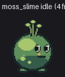
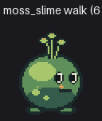
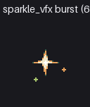
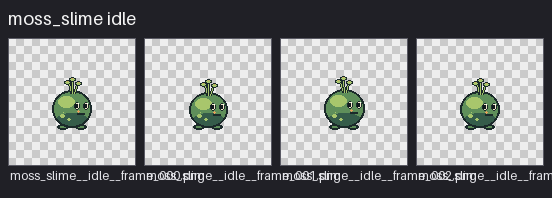

# 2D Sprite Studio


[](https://github.com/Teerth-Sonawani/Sprite-Studio/actions/workflows/ci.yml)

A production-oriented, agent-friendly workspace for planning, generating,
processing, animating, validating and exporting 2D game art. Every stage reads and
writes structured files, and no stage is allowed to claim visual approval without
evidence.

The workspace is deliberately split: image generation is one replaceable step;
processing, animation, QA and export do not depend on a particular provider.

## Built for the models you actually run

Deterministic Python does all the hard work — pixel math, edge tracing, hashing,
schema validation — so a small model gets the same correct results as a large
one. Model capability only matters at one step, and that step is vision.

- **Vision models** (DeepSeek V4.1 Flash, Qwen2.5-VL-class, any cheap
  multimodal API) act as the reviewer of record: the pipeline renders contact
  sheets, alpha overlays and previews as evidence files, and the model scores
  them through `tools/qa_review.py`.
- **Text-only and free-tier models** (the ones bundled with agents like
  OpenCode) drive every other stage end to end — each stage is file-in/file-out
  with no hidden state.
- **No model can fake an approval**: the manifest records reviewer, scope and
  evidence paths, and validation fails if the evidence files are missing.

<p align="center">
  
  
  
</p>

<p align="center">
  <sub>Example assets are original procedural Pillow art, not AI-generated. They prove the pipeline, not provider image quality.</sub>
</p>

## Why this exists

Most "AI sprite" tools stop when an image appears. This project treats generation
as a candidate, not a delivery. The useful part is everything after the prompt:

- freeze a style before producing a set;
- remove backgrounds edge-aware instead of applying a global colour key;
- align frames to a shared canvas and pivot;
- validate animation loops, bounds and scale;
- record technical and visual QA separately;
- keep provider, prompt, model, hashes and file paths in a portable manifest;
- export a package an engine can actually consume.

See [`AGENTS.md`](AGENTS.md) for the non-negotiable operating rules.

## Preview

| Moss slime contact sheet | Sprite sheet cells |
| --- | --- |
|  |  |

## What works today

| Area | Status | Entry points |
| --- | --- | --- |
| Image inspection, alpha analysis, palette extraction | Implemented and tested | `tools/inspect_image.py`, `tools/palette_check.py` |
| Edge-connected background removal and alpha cleanup | Implemented and tested | `tools/remove_background.py`, `tools/clean_transparency.py` |
| Frame alignment, previews (GIF/APNG/WebP/MP4), animation validation | Implemented and tested | `tools/align_frames.py`, `tools/preview_animation.py`, `tools/validate_animation.py` |
| Sprite-sheet slicing, assembly, contact sheets, atlas packing | Implemented and tested | `tools/slice_spritesheet.py`, `tools/build_spritesheet.py`, `tools/pack_atlas.py` |
| Tile seam diagnostics and 2D wrap previews | Implemented and tested | `tools/tile_seam_check.py` |
| Manifest generation, schema validation and provenance | Implemented and tested | `tools/generate_manifest.py`, `schemas/` |
| Technical QA and evidence-backed visual review | Implemented and tested | `tools/validate_sprite.py`, `tools/qa_review.py` |
| Generic, Godot 4 and Unity 2022 exports | Implemented; engine artifacts are practical templates | `tools/export_asset.py`, `docs/GAME_ENGINE_EXPORT.md` |
| Mock provider (offline, deterministic) | Implemented and tested | `sprite_studio/providers/mock/` |
| Perchance manual handoff | Implemented | `sprite_studio/providers/perchance/adapter.py` |
| PerchanceAI developer API | Implemented, credential-gated; live model discovery verified | `docs/PERCHANCE_INTEGRATION.md` |
| `perchance.org/api-tutorial` integration | **Not usable**; documented endpoint returned HTTP 404 | `docs/PERCHANCE_INTEGRATION.md` |
| Aseprite native `.aseprite` writer | **Not implemented**; the exporter refuses honestly | `sprite_studio/export.py` |

## Requirements

- Python 3.10 or newer (developed and tested with 3.12.4).
- Windows, macOS or Linux; CI tests Ubuntu and Windows.
- No system FFmpeg is required when `imageio-ffmpeg` is installed.

## Installation

```bash
git clone https://github.com/Teerth-Sonawani/Sprite-Studio.git
cd Sprite-Studio

python -m venv .venv
# Windows: .venv\Scripts\activate
# macOS/Linux: source .venv/bin/activate

python -m pip install --upgrade pip
python -m pip install -e ".[all]"
```

`.[all]` installs optional video, SciPy and test extras. For the core pipeline
only:

```bash
python -m pip install -e .
```

## Quick start

PowerShell line continuations use a backtick. On macOS/Linux use `python3` and
`\`, or put each command on one line.

```powershell
# Inspect a frame and its palette
python tools/inspect_image.py projects/example-project/assets/approved/moss_slime/frames/idle/moss_slime__idle__frame_000.png --palette

# Validate one sprite technically
python tools/validate_sprite.py projects/example-project/assets/approved/moss_slime/frames/idle/moss_slime__idle__frame_000.png `
  --width 64 --height 64 --transparency --padding 2 --pivot-x 32 --pivot-y 60 `
  --report projects/example-project/assets/working/moss_slime_frame_technical.json

# Rebuild an animated preview
python tools/preview_animation.py projects/example-project/assets/approved/moss_slime/frames/idle `
  --output projects/example-project/exports/previews/moss_slime_idle.gif `
  --frames-per-second 6 --overwrite

# Rebuild the whole example project (assets -> reviews -> exports)
python scripts/build_demo_assets.py --stage all

# Run the test suite
python -m pytest -q
```

Expected demo result: four `TECHNICAL_PASS` assets, four AI review records
applied, six export jobs, and manifest hash verification passing for 36 files.

## The operating loop

```text
plan -> reference -> generate -> process -> animate -> validate -> correct -> export
```

A candidate must pass deterministic technical checks and an evidence-backed
visual review before it can be marked `APPROVED`. AI review never sets
`human_approved`; that stays `false` until a human signs off.

| Status | Meaning | May export? |
| --- | --- | --- |
| `PENDING` | Created, not technically validated | No |
| `TECHNICAL_PASS` | Deterministic checks passed; no visual review | Demo only |
| `VISUAL_REVIEW` | Reviewer requested changes, or demo/internal | With an explicit demo label |
| `APPROVED` | Technical pass plus recorded visual approval | Yes, within scope |
| `REJECTED` | Failed a gate; do not ship as production | No |

## Example project

[`projects/example-project/`](projects/example-project/) is a complete, reproducible
walkthrough:

| Asset | Content | QA |
| --- | --- | --- |
| `moss_slime` | 4 idle + 6 walk frames, 64x64, pivot (32, 60) | `APPROVED` (AI, demo scope) |
| `grass_tile` | 32x32 seamless tile plus wrap previews | `APPROVED` (AI, demo scope) |
| `ui_sparkle` | 32x32 transparent icon | `APPROVED` (AI, demo scope) |
| `sparkle_vfx` | 6-frame 64x64 burst plus sheet | `APPROVED` (AI, demo scope) |

Start with its [README](projects/example-project/README.md), then read the
technical report, animation report, contact sheet, review record, manifest and
engine export in that order. Every manifest records real provenance, including
`provider: scripted_pillow` and `mode: procedural_demo` for the checked-in art.

## Repository layout

```text
2d-sprite-studio/
├── README.md                 Overview and quick start
├── AGENTS.md                 Mandatory operating rules for agents and humans
├── CHANGELOG.md              Release history
├── CONTRIBUTING.md           Development setup and contribution rules
├── SECURITY.md               Private reporting and security model
├── config/                   Style, category, animation, QA and export registries
├── docs/                     Workflow, art direction, processing, QA and export docs
├── schemas/                  JSON Schemas for briefs, style guides, animations, manifests
├── sprite_studio/            Reusable Python package behind the CLI tools
│   ├── providers/            Provider interface, registry, mock and Perchance adapters
│   └── tools/                Tool implementations (installed as `sprite-*` commands)
├── tools/                    Thin shims for `python tools/<name>.py`
├── templates/                YAML/Markdown starting points
├── references/               Style selection notes and worked examples
├── projects/example-project/ Complete sample project, demo art, QA and exports
├── tests/                    Unit, integration and acceptance tests
└── scripts/                  Reproducible demo-asset and verification scripts
```

## Documentation

- [`AGENTS.md`](AGENTS.md) — operating rules, status lifecycle and phase checklist.
- [`docs/WORKFLOW.md`](docs/WORKFLOW.md) — full phase-by-phase procedure.
- [`docs/ART_DIRECTION.md`](docs/ART_DIRECTION.md) — styles, palettes and references.
- [`docs/ASSET_TYPES.md`](docs/ASSET_TYPES.md) — characters, environments, UI and VFX.
- [`docs/IMAGE_PROCESSING.md`](docs/IMAGE_PROCESSING.md) — background removal, alpha cleanup and resizing.
- [`docs/ANIMATION.md`](docs/ANIMATION.md) — timing, loops, pivots and validation.
- [`docs/SPRITE_SHEETS.md`](docs/SPRITE_SHEETS.md) — sheets, slicing, packing and metadata.
- [`docs/QUALITY_ASSURANCE.md`](docs/QUALITY_ASSURANCE.md) — technical and visual gates.
- [`docs/GAME_ENGINE_EXPORT.md`](docs/GAME_ENGINE_EXPORT.md) — generic, Godot 4 and Unity 2022.
- [`docs/PERCHANCE_INTEGRATION.md`](docs/PERCHANCE_INTEGRATION.md) — supported modes and verified status.
- [`docs/TROUBLESHOOTING.md`](docs/TROUBLESHOOTING.md) — common failures and fixes.

## Configuration and extension

Configuration read by the tools at runtime:

- Providers: `config/providers.yaml`, discovered by
  `sprite_studio/providers/provider_registry.py`.
- Studio defaults: `config/studio.yaml` (default provider and generation output
  folder).
- QA profiles: `config/quality_profiles.yaml`. Use
  `python tools/validate_sprite.py IMAGE --profile character`; explicit flags
  still override the profile.
- Export profiles: `config/export_profiles.yaml`. Every implemented exporter
  must have a matching documented profile.

Reference registries used when authoring briefs and documentation (they are not
read by the runtime):

- Styles: `config/art_styles.yaml` (13 starting styles).
- Asset categories: `config/asset_categories.yaml`.
- Animation presets: `config/animation_presets.yaml`.

Custom fields in briefs and manifests are preserved. Adding a provider means
implementing the `ImageProvider` interface in
`sprite_studio/providers/base_provider.py`.

## Installed commands

`pip install -e ".[all]"` installs twenty console commands named `sprite-*`
(for example `sprite-inspect-image`, `sprite-validate-sprite` and
`sprite-export-asset`). The `python tools/<name>.py` form keeps working too.

Every report, manifest and export honours `SOURCE_DATE_EPOCH` (seconds since the
Unix epoch). Set it to get byte-identical rebuilds; CI builds the example
project twice and fails if the two runs differ.

Configuration and schemas are resolved relative to the repository root, so an
editable install (`pip install -e .`) is the supported way to run the tools from
an arbitrary working directory. A plain wheel does not bundle `config/` or
`schemas/`.

## Security and secrets

`PERCHANCEAI_API_KEY` is read from the environment only, and `.env` is ignored
by git. The adapter never accepts a key as a CLI flag, never writes it to
prompts or logs, and never sends a bearer token to a signed output URL.
Chargeable requests require an estimate, a credit limit and `--confirm`; an
uncertain submission is not retried with a fresh idempotency key. No bundled
code bypasses Cloudflare, reverse-engineers private endpoints or automates a
browser challenge.

See [`SECURITY.md`](SECURITY.md) for private reporting and the full model.

## Development

```bash
python -m pytest -q
python scripts/build_demo_assets.py --stage all
python -m compileall -q sprite_studio tools
```

The test suite makes no network calls and needs no provider credentials. See
[`CONTRIBUTING.md`](CONTRIBUTING.md) for setup, style and pull-request rules,
[`SUPPORT.md`](SUPPORT.md) for support questions, and the CI badge above for
the current build state.

## License

MIT. See [`LICENSE`](LICENSE) for the full text.

The example art is original procedural work. Generated assets remain subject to
the provider's terms and the model's licence; provenance metadata is not a licence
grant.

## Acknowledgements

Built around Pillow, NumPy, PyYAML and jsonschema, with optional support from
imageio, imageio-ffmpeg and SciPy. The Godot and Unity export formats follow the
public resource formats of those engines; the exporters are independent and are
not affiliated with either project.
